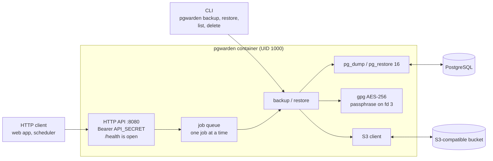
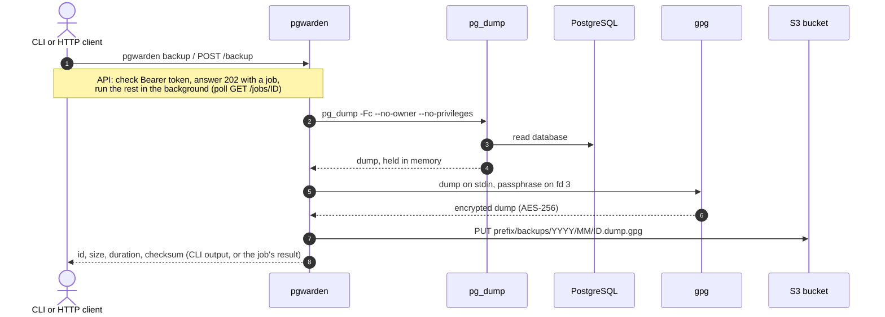
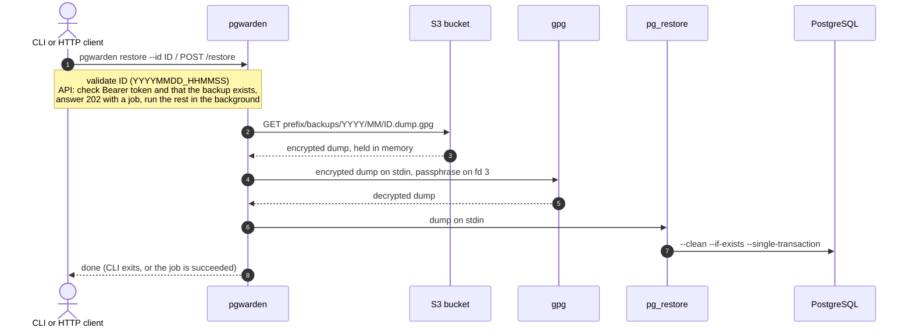

# pgwarden

pgwarden is a lightweight Docker tool for PostgreSQL backup and restore. It uses `pg_dump` to create backups, encrypts them with GPG, and stores them in any S3-compatible storage (AWS S3, Cloudflare R2, MinIO, Backblaze, DigitalOcean, GCS, etc.).

**Why pgwarden?**

- **Docker-first**: Single container, runs anywhere Docker runs
- **Mandatory encryption**: All backups encrypted with GPG AES-256, no plaintext option
- **Non-root by default**: Runs as UID 1000
- **Lightweight**: Alpine-based image, ~18MB download
- **S3-compatible**: Works with any S3-compatible storage, not just AWS
- **Simple**: One binary, no complex configuration, no dependencies
- **HTTP API**: Trigger backup/restore from web apps
- **Health check**: Built-in `/health` endpoint for monitoring

## Features

- **pg_dump backup**: Custom format (-Fc), compressed
- **S3-compatible storage**: AWS S3, R2, MinIO, Backblaze, DigitalOcean, GCS, etc.
- **Restore**: pg_restore from S3 with one command
- **HTTP API**: For integration with web apps
- **CLI**: Manual backup, restore, list, delete
- **Mandatory GPG encryption**: All backups encrypted with AES-256 (no plaintext option)
- **Non-root user**: Runs as `pgwarden` (UID 1000)
- **Lightweight image**: Alpine-based Docker image, ~18MB download (~64MB unpacked)
- **Health endpoint**: HTTP `/health` for monitoring and load balancers
- **OCI labels**: Container metadata for registries

## Quick Start

### Prerequisites

- Docker installed
- PostgreSQL 16 or older, accessible from Docker (host network or Docker network).
  The image ships `pg_dump` 16, which cannot dump a newer server.
- S3-compatible storage (AWS S3, R2, MinIO, etc.)
- A GPG passphrase you keep somewhere safe. **Every restore needs it; if it is
  lost, the backups cannot be decrypted.**

The image is published as `ghcr.io/rfqma/pgwarden` (`:0.2.3`, `:0.2`, `:latest`).

### Single Docker Command

```bash
# Generate the passphrase once and store it (password manager, secret store).
# Do not generate it inline in the command: you need the same one to restore.
export GPG_PASSPHRASE='your-stored-passphrase'

docker run --rm --network host \
  -e PGHOST=localhost \
  -e PGPORT=5432 \
  -e PGUSER=postgres \
  -e PGPASSWORD=secret \
  -e PGDATABASE=mydb \
  -e S3_ENDPOINT=s3.amazonaws.com \
  -e S3_BUCKET=my-backups \
  -e S3_PREFIX=pgwarden \
  -e S3_ACCESS_KEY=xx \
  -e S3_SECRET_KEY=xx \
  -e S3_REGION=auto \
  -e GPG_PASSPHRASE \
  ghcr.io/rfqma/pgwarden:0.2.3 backup
```

### Docker Compose

Create `docker-compose.yml`:

```yaml
services:
  postgres:
    image: postgres:16
    environment:
      POSTGRES_DB: mydb
      POSTGRES_PASSWORD: secret
    healthcheck:
      test: ["CMD-SHELL", "pg_isready -U postgres -d mydb"]
      interval: 5s
      timeout: 5s
      retries: 10

  pgwarden:
    image: ghcr.io/rfqma/pgwarden:0.2.3
    container_name: pgwarden
    depends_on:
      postgres:
        condition: service_healthy
    env_file:
      - .env
    environment:
      # Inside Compose, Postgres is reached by its service name.
      PGHOST: postgres
      PGUSER: postgres
      PGPASSWORD: secret
      PGDATABASE: mydb
    ports:
      - "127.0.0.1:8080:8080"
    healthcheck:
      test: ["CMD", "wget", "-qO-", "http://localhost:8080/health"]
      interval: 30s
      timeout: 5s
      retries: 3
      start_period: 10s
```

The container runs `pgwarden serve` by default, which requires `API_SECRET`.
Port 8080 is bound to localhost only; expose it further only behind TLS.

Run with:

```bash
# Set env vars (copy from .env.example)
cp .env.example .env
# Edit .env: S3_*, GPG_PASSPHRASE and API_SECRET
# (openssl rand -base64 32 for API_SECRET)

# Start services
docker compose up -d

# Run a one-off backup
docker compose run --rm pgwarden backup
```

### Local Binary (Development)

```bash
# Build
go build -o pgwarden ./cmd/pgwarden

# Set env vars (copy from .env.example)
cp .env.example .env
# Edit .env with your credentials

# Run
./pgwarden backup
```

## CLI Usage

```bash
# Create backup
pgwarden backup

# List all backups
pgwarden list

# Restore from backup
pgwarden restore --id 20260726_071210

# Delete backup
pgwarden delete --id 20260726_071210

# Start HTTP API server
pgwarden serve

# Liveness check: prints "ok" if the binary runs.
# It does not check PostgreSQL, S3 or the API server.
pgwarden health

# Show help
pgwarden --help
pgwarden backup --help
```

Backup IDs have the form `YYYYMMDD_HHMMSS` (the time the backup started).
`restore` and `delete` reject anything else.

One pgwarden process runs backups one at a time and never reuses an ID. A
backup from another process (the CLI next to the API, or a second replica)
that lands on an ID already in the bucket fails with "already exists"
instead of overwriting it; run it again.

pgwarden has no built-in scheduler. Run `pgwarden backup` from cron, a
Kubernetes CronJob, or a scheduled `POST /backup`.

## HTTP API

| Method   | Endpoint        | Description                     | Auth |
| -------- | --------------- | ------------------------------- | ---- |
| `GET`    | `/health`       | Health check                    | No   |
| `POST`   | `/backup`       | Queue a backup (returns a job)  | Yes  |
| `POST`   | `/restore`      | Queue a restore (returns a job) | Yes  |
| `GET`    | `/jobs/{id}`    | Status and result of a job      | Yes  |
| `GET`    | `/backups`      | List all backups                | Yes  |
| `DELETE` | `/backups/{id}` | Delete backup                   | Yes  |

All endpoints except `/health` need `Authorization: Bearer <API_SECRET>`;
without it they answer `401`. An invalid backup ID answers `400`.

### Jobs

A backup or restore can take longer than any HTTP client or proxy will wait,
so `POST /backup` and `POST /restore` do not wait for it. They answer
`202 Accepted` at once with a job, and the work runs in the background.
Poll `GET /jobs/{id}` (also given in the `Location` header) until `status`
is `succeeded` or `failed`:

| Field         | Description                                                       |
| ------------- | ----------------------------------------------------------------- |
| `job_id`      | Job ID                                                            |
| `type`        | `backup` or `restore`                                             |
| `status`      | `queued`, `running`, `succeeded` or `failed`                      |
| `result`      | Backup only, once succeeded: `id`, `size`, `duration`, `checksum`, `created_at` |
| `backup_id`   | Restore only: the backup being restored                           |
| `error`       | Once failed: why                                                  |
| `created_at`, `started_at`, `finished_at` | Timestamps                            |

- Jobs run one at a time, in the order they were queued. A client that
  disconnects or times out does not stop its job.
- Up to 16 jobs can wait in the queue; beyond that `POST` answers `503`.
- `POST /restore` answers `404` at once if the backup does not exist.
- Job status lives in memory: the last 100 finished jobs are kept, and all
  are lost when pgwarden restarts (`GET /jobs/{id}` then answers `404`).
  The backups themselves are in the bucket; check `GET /backups`.
- Stopping pgwarden (SIGTERM) cancels a running job. An interrupted restore
  rolls back; an interrupted backup is not uploaded.
- Every job is logged: `[pgwarden] job <id> backup succeeded after 40.1s`.

### Examples

```bash
AUTH="Authorization: Bearer $API_SECRET"

# Health check (no token)
curl http://localhost:8080/health
# {"status":"ok"}

# Queue a backup
curl -X POST -H "$AUTH" http://localhost:8080/backup
# 202 {"job_id":"a97a3638570173d36024713f","type":"backup","status":"queued","created_at":"..."}

# Poll the job
curl -H "$AUTH" http://localhost:8080/jobs/a97a3638570173d36024713f
# {"job_id":"a97a3638570173d36024713f","type":"backup","status":"running",...}
# {"job_id":"a97a3638570173d36024713f","type":"backup","status":"succeeded",
#  "result":{"id":"20260726_071210","size":151018,"duration":"25.88s","checksum":"...","created_at":"..."},...}

# List backups
curl -H "$AUTH" http://localhost:8080/backups
# [{"key":"pgwarden/backups/2026/07/20260726_071210.dump.gpg","size":151018,"modified":"..."}]

# Queue a restore, then poll its job the same way
curl -X POST -H "$AUTH" http://localhost:8080/restore -H "Content-Type: application/json" -d '{"id":"20260726_071210"}'
# 202 {"job_id":"ee9a1d3f3909e461b5de94db","type":"restore","status":"queued","backup_id":"20260726_071210",...}

# Delete backup
curl -X DELETE -H "$AUTH" http://localhost:8080/backups/20260726_071210
# {"deleted":true,"id":"20260726_071210"}
```

A restore replaces the current contents of the database (`pg_restore
--clean`) in a single transaction.

Before 0.3.0, `POST /backup` and `POST /restore` waited for the work and
answered `200` with its result; clients written for that must now poll the job.

## Environment Variables

### PostgreSQL

| Variable     | Default     | Description         |
| ------------ | ----------- | ------------------- |
| `PGHOST`     | `localhost` | PostgreSQL host     |
| `PGPORT`     | `5432`      | PostgreSQL port     |
| `PGUSER`     | `postgres`  | PostgreSQL user     |
| `PGPASSWORD` | —           | PostgreSQL password |
| `PGDATABASE` | `postgres`  | PostgreSQL database |

Other [libpq variables](https://www.postgresql.org/docs/16/libpq-envars.html)
such as `PGSSLMODE`, `PGSSLROOTCERT` or `PGCONNECT_TIMEOUT` are passed to
`pg_dump` and `pg_restore` as set. pgwarden's own secrets (`GPG_PASSPHRASE`,
`S3_ACCESS_KEY`, `S3_SECRET_KEY`, `API_SECRET`) are not.

### S3 Storage

| Variable        | Default            | Description                                                                 |
| --------------- | ------------------ | --------------------------------------------------------------------------- |
| `S3_ENDPOINT`   | `s3.amazonaws.com` | Host (e.g. `minio:9000`) or full URL with `http://` / `https://`            |
| `S3_BUCKET`     | —                  | S3 bucket name (required)                                                   |
| `S3_PREFIX`     | `pgwarden`         | Key prefix for backups                                                      |
| `S3_REGION`     | —                  | Region used to sign requests. Not detected: set it for AWS S3; `auto` for R2 |
| `S3_ACCESS_KEY` | —                  | S3 access key                                                               |
| `S3_SECRET_KEY` | —                  | S3 secret key                                                               |
| `S3_USE_SSL`    | `true`             | Scheme for an `S3_ENDPOINT` without one: `https` if true, `http` if false   |

### Security

| Variable         | Default | Description                                               |
| ---------------- | ------- | --------------------------------------------------------- |
| `GPG_PASSPHRASE` | —       | GPG encryption passphrase (required)                      |
| `API_SECRET`     | —       | API auth secret (required by `serve`)                     |
| `API_INSECURE`   | `false` | Let `serve` run without `API_SECRET` (development only)   |

### API Server

| Variable   | Default | Description          |
| ---------- | ------- | -------------------- |
| `API_PORT` | `8080`  | HTTP API server port |

## Architecture

### Overview



pgwarden is one binary in one container. Backups are triggered from the CLI
or the HTTP API (or a scheduler calling either); there is no built-in schedule.
It shells out to `pg_dump`, `pg_restore` and `gpg`, and talks to the bucket
with the AWS SDK. Backup data is never written to local disk.

### Backup Flow



### Restore Flow



Each step works on the whole file in memory: the dump and its encrypted
copy are both held at once, as are the download and its decrypted copy.
Give the container at least about twice the size of a dump in memory.

### Backup File Format

All backups are stored as `.dump.gpg` files:

```
<bucket>/
└── pgwarden/                  ← S3_PREFIX
    └── backups/
        └── 2026/
            ├── 07/
            │   ├── 20260726_071210.dump.gpg
            │   ├── 20260726_081200.dump.gpg
            │   └── 20260726_091200.dump.gpg
            └── 08/
                └── ...
```

**File naming:** `{S3_PREFIX}/backups/{YYYY}/{MM}/{YYYYMMDD_HHMMSS}.dump.gpg`

**File format:** pg_dump custom format (`-Fc`), encrypted with GPG AES-256

## Security

### Encryption

**All backups are encrypted** using GPG symmetric encryption with AES-256:

- **Algorithm:** AES-256 (symmetric)
- **Key derivation:** GPG standard (S2K)
- **Format:** GPG binary format
- **No plaintext option** — `GPG_PASSPHRASE` is mandatory
- **Passphrase never on the command line** — it reaches gpg over a pipe (`--passphrase-fd`), so it does not appear in `ps` or `/proc/<pid>/cmdline`

```bash
# The dump is encrypted before it leaves the container
pgwarden backup
# → Creates .dump.gpg file in S3
```

### Non-Root User

pgwarden runs as a non-root user by default:

- **User:** `pgwarden` (UID 1000)
- **Group:** `pgwarden` (GID 1000)
- **Shell:** `/bin/sh` (Alpine `adduser` default)
- **Home:** `/home/pgwarden`

The image does not block privilege escalation by itself; add
`--security-opt no-new-privileges` (or `security_opt` in Compose) for that.

### API Authentication

`pgwarden serve` refuses to start without `API_SECRET`: an open API lets
anyone who can reach the port restore over your database or delete your
backups. `/health` is the only endpoint that needs no token.

```bash
docker run -e API_SECRET=my-secret pgwarden serve

# Without auth (development only)
docker run -e API_INSECURE=true pgwarden serve

# All requests must include:
curl -H "Authorization: Bearer my-secret" http://localhost:8080/backups
```

### Best Practices

1. **Generate strong passphrases:**

   ```bash
   GPG_PASSPHRASE=$(openssl rand -base64 32)
   ```

2. **Store secrets securely:**
   - Use Docker secrets, Kubernetes secrets, or `.env` files (not in code)
   - Never commit `.env` files to Git

3. **Keep the API private:**
   - Always set `API_SECRET`; bind the port to localhost or a private network
   - Put TLS in front of it if it must cross a network

4. **Use HTTPS for S3:**
   - Set `S3_USE_SSL=true` (default)
   - Use cloud provider TLS endpoints

5. **Rotating the passphrase:**
   - pgwarden uses one `GPG_PASSPHRASE` for both backup and restore, and does
     not record which passphrase encrypted which backup
   - After rotating, keep the old passphrase and note the date you switched
   - To restore a backup from before that date, run `restore` with
     `GPG_PASSPHRASE` set to the old passphrase

6. **Back up your passphrase:**
   - Store in password manager
   - Keep offline backup in secure location
   - **If lost, backups are unrecoverable**

## Image Details

### Base

- **Base image:** `alpine:3.20`
- **Final image:** ~18MB download, ~64MB unpacked
- **Runtime:** pg_dump, pg_restore, gpg
- **Platforms:** `linux/amd64`, `linux/arm64`

### Components

| Component         | Source            | Version |
| ----------------- | ----------------- | ------- |
| Go binary         | Build from source | 1.25+   |
| PostgreSQL client | Alpine packages   | 16.x (dumps servers up to 16) |
| GPG               | Alpine packages   | 2.4+    |
| CA certificates   | Alpine            | Latest  |

### OCI Labels

Released images carry labels set by the release workflow
(`docker/metadata-action`), including:

```yaml
org.opencontainers.image.title: pgwarden
org.opencontainers.image.version: 0.2.3          # the release
org.opencontainers.image.revision: <commit SHA>
org.opencontainers.image.source: https://github.com/rfqma/pgwarden
org.opencontainers.image.licenses: Apache-2.0
org.opencontainers.image.created: <build time>
```

### Health Check

The image's `HEALTHCHECK` runs `pgwarden health`, which prints `ok` when the
binary starts. It does not check PostgreSQL, S3 or the API. To check that the
API server answers, probe `/health` instead (as in the Compose example):

```bash
wget -qO- http://localhost:8080/health
# {"status":"ok"}
```

## Development

### Build from Source

```bash
# Clone repository
git clone https://github.com/rfqma/pgwarden.git
cd pgwarden

# Build binary
go build -o pgwarden ./cmd/pgwarden

# Run
./pgwarden backup
```

### Build Docker Image

```bash
# Build local image
docker build -t pgwarden:dev .

# Test
docker run --rm --network host --env-file .env pgwarden:dev backup
```

## License

Copyright 2026 rfqma

Licensed under the [Apache License, Version 2.0](LICENSE). You may use,
modify and distribute pgwarden, including commercially, under its terms.
